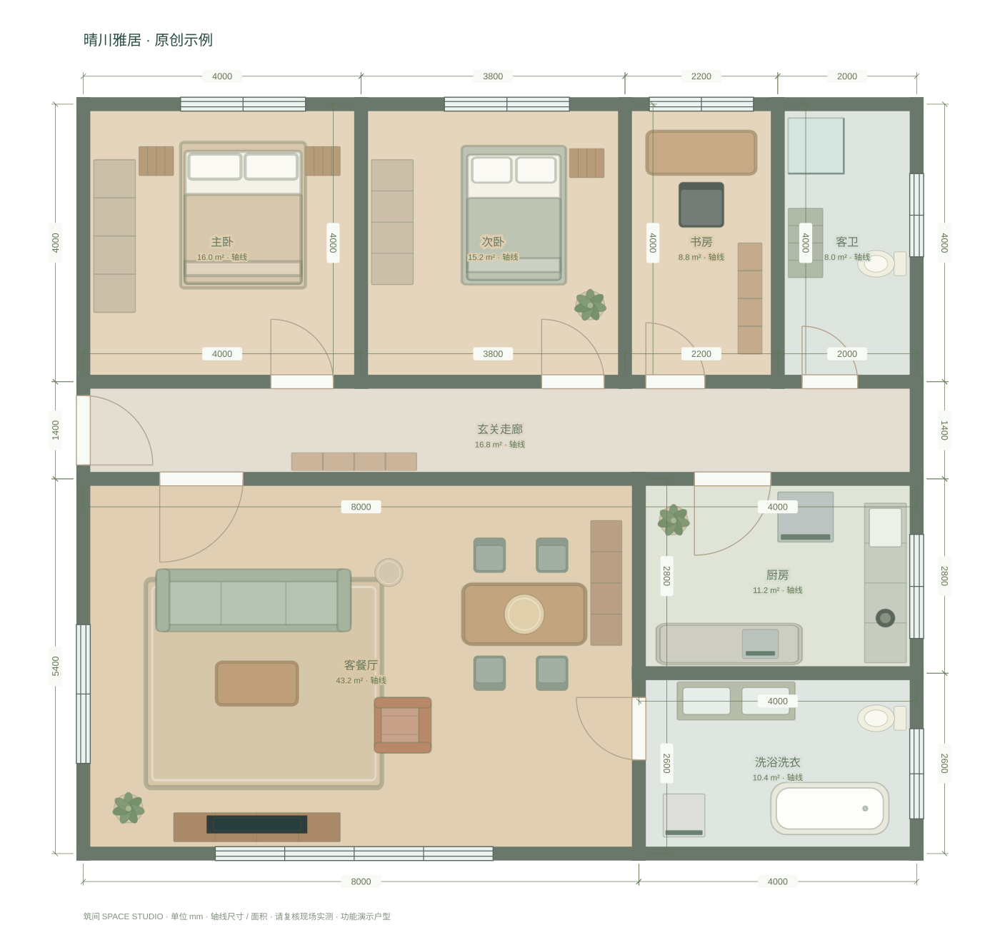

# 筑间 · 手绘到空间 V0.12

一个支持多项目的本地户型编辑工作台：草图底图 → 精确二维编辑 → CAD 尺寸图 → 三维家居布置。

## V0.12：原创示例与开源准备

**晴川雅居**：129.6 m² 轴线围合面积，两卧＋书房、双卫、独立厨房、客餐厅与玄关，39 件可编辑家具家电。首页「探索晴川雅居」打开全新副本，不覆盖已有方案。



- 当前源码与部署不再包含个人手绘图片、读图快照或私人尺寸记录；底图面板可上传自己的图片，或使用原创示例练习。
- 示例图、可导入项目 JSON、尺寸审查教学数据由同一模型生成：`node scripts/build-showcase.mjs`。它不是 AI 识别结果。
- 已有项目中的停用内置底图引用在打开时移除；用户已编辑的墙体与家具保留。自行上传的图片仍由用户管理。
- 原创代码和示例采用 MIT；Three.js 的独立版权声明保留。见 [LICENSE](LICENSE)、[THIRD_PARTY_NOTICES.md](THIRD_PARTY_NOTICES.md)。
- GitHub 发布步骤见 [docs/OPEN_SOURCE.md](docs/OPEN_SOURCE.md)。使用本版干净源码包创建新仓库，不推送以前含个人素材的 Git 历史。源码仓库：[huangkang9/zhujian-studio](https://github.com/huangkang9/zhujian-studio)。

## V0.11：中文 / English

点击右上角 **EN / 中文**，即时切换并记住选择。覆盖编辑器、家具与材质、沉浸模式、AI 审查、预算、提示和导出；家具和命令支持两种语言搜索。

切换保留选中对象、未提交输入和项目数据。自定义项目／房间／家具名、品牌备注、草图原始读数及服务商返回的原文不自动翻译。毫米、平方米和人民币金额不因语言改变。SVG、DXF、打印图框与预算 CSV 使用当前语言，JSON 保持原始数据。

English: click **EN** to use the editor in English. Your project data and custom names stay unchanged. Run `npm ci`, then `npm start` (Node.js 22.13+). See [localization maintenance](docs/LOCALIZATION.md) for translation coverage and boundaries.

## V0.10：家具家电、结构标记与测量图层

参考 [wy51ai/floorplan-3d](https://github.com/wy51ai/floorplan-3d) 的功能组织，完整对照与未移植范围见 [docs/REFERENCE-FLOORPLAN-3D.md](docs/REFERENCE-FLOORPLAN-3D.md)。

- **家具库现有 60 款**：新增 20 款育儿、厨房、家电及休闲模型；均可调整宽／深／高、离地、旋转、颜色和样式，进入原有项目保存、撤销、三维和预算流程。
- **选墙 → 墙体结构**：默认待核实，可手动标记非承重／承重。承重墙禁改几何、共享端点和洞口，保留饰面、门扇开合及颜色编辑；更正标记需明确确认。
- **顶部「图层」**：独立控制尺寸与测量、房间名称面积、家具、网格、结构标记；项目内保存、撤销。红为承重，蓝为非承重，灰为待核实；家具同时影响二维与三维。
- **测量工具 L**：吸附墙体两侧实际墙面；按 Shift 锁定水平／垂直。预览和落点一致，门洞位置不吸附为实体墙。自由测量不随墙体修改移动。
- **DXF**：承重和非承重墙分别放入 WALL_BEARING / WALL_PARTITION 图层，未核实墙保留 WALL。导出完整图纸不受编辑器图层隐藏影响。
- **图纸检查**：提示尚未核实的结构信息，优先显示错误，再显示提醒。

结构声明不表示允许拆改；本轮尚未实现完整拆改图和自动净面积。90 项自动测试、类型检查通过；真实 WebGL 画面、移动触屏仍待验收。

## V0.9：硬装、灯光与装修估算

- **选中房间**：调整平顶／整体下吊、顶面颜色、踢脚线高度／厚度／颜色；漫游时显示顶面。下吊改变净高，也影响可站立空间和家具碰顶检查。
- **选中房间或灯具**：光源独立开关，2200–6500 K 色温，0–300% 相对强度，随昼夜自动／日间常亮。灯具现在产生实时点光，而不只是表面发光；最多 16 个启用光源，房间基础灯优先。
- **顶部「用量 / 预算」**：地面、扣洞口后的墙面、顶面、踢脚线和家具清单。主材／辅料／人工分开、主材损耗、预备费、目标预算、房间筛选、品牌备注、项目计入开关。未报价明确保留为空，不虚构市场单价。
- **自定义费用**：补充水电、拆改、防水、安装、运输等，输入工程量和单位。支持删除、撤销和 CSV 导出，保留中文与报价状态。
- **图纸检查**：增加门扇扫掠与家具冲突、家具超出顶下净高的定位提示。闭门默认按 90° 检查；只进行轮廓近似检查，不是规范审查。
- 硬装、灯光与预算进入同一份项目 JSON，随自动保存、恢复和撤销流转；旧 version 1 项目兼容。

算量基于轴线围合面积，不等于净面积或精确排料。改变房间拓扑后需重新核对材质和预算；更换商品款式或材料后需重新核价。灯光不是 IES／照度计算。完整差距、优先级和边界见 [docs/PRODUCT-GAPS.md](docs/PRODUCT-GAPS.md)。

## V0.8：交付检查、按比例图框与保存保护

- 工作台「图纸检查」：检查墙体交叉未连接、共线重叠、自由端点、门窗范围和家具轴线相交。可定位对象，下载 JSON 检查记录。AI 草稿和未校准底图保留复核提示。
- 「导出图纸 → 按比例打印 / PDF」：A4 / A3、横向 / 纵向、1:25 / 50 / 75 / 100 / 150 / 200 / 500。带标题、日期、毫米单位、轴线面积及 50 mm 纸面长度的比例尺，可下载图框 SVG。
- 使用物理毫米尺寸生成 SVG；内容放不下时停用打印，不自动缩放。打印需选择实际大小 / 100%，关闭页眉页脚，并在输出后核对比例尺。它不是施工图审查；打印驱动效果需实测。
- 保存按编辑版本确认，旧保存完成不会误标新编辑；隐藏页面时尝试刷新待保存内容，有未保存修改时使用浏览器离开提示。浏览器强制退出不保证写入，请下载 JSON 备份。
- 切换项目先保存，失败时保留当前方案。用户可重试，或明确选择下载 JSON 备份后打开新方案；异步导图不会误放到另一个项目。
- 合并重复的材质 / 颜色入口，改善字号、色卡点击面积和焦点恢复；保留底图透明度键盘修改的撤销记录。快速请求三维视图共用同一次初始化。

## V0.7：独立样式与自定义颜色

**普通工作台**：点选墙体、房间地面或家具 → 右侧「样式与颜色」。
**氛围工作室**：点选对象 → 浮动条「样式 / 颜色」。

- 墙面 9 种样式：纯色哑光、细砂艺术漆、砖墙、工字砖、护墙板、竖向木格栅、方砖、木纹、大理石纹。
- 地面 8 种样式：纯色、工字砖、方砖、斜铺、棋盘格、直铺木纹、篮编拼木、大理石。
- 家具 7 种表面：纯色、木纹、亚麻织纹、圈绒、皮革、大理石、拉丝金属。可以在同空间分类中更换现有家具款式，保留位置、尺寸、旋转和主色。
- 调色器、#RRGGBB 色号、10 枚快捷色卡；样式与颜色独立。用户调过的颜色在切换原有材质样板时也保留，恢复默认按钮同时重置样式和颜色。
- 图案支持单元尺度（100～2000 mm）、铺设方向；砖缝等适用图案可调缝色和宽度。它们是三维材质预览参数，缝宽受纹理分辨率影响，不作为施工放样尺寸。
- 所有外观随项目保存、恢复和撤销，家具复制独立保存表面参数，修改复制件不会联动原家具。
- 砖墙、护墙板、格栅等目前为程序化表面纹理，不添加真实凹槽／凸起几何；家具修改主要表面，固定配件、床品细节等仍保留构件默认材质。门窗仍使用已有框色、门扇颜色与窗分格设置。

## V0.6：氛围工作室

参考 https://sael.net/interior/ 的材质、家具与光照交互，新增独立的全屏工作室，仍使用当前项目的同一份毫米数据。没有复制参考站源码、品牌或素材。

入口：编辑器上方「✧ 氛围工作室」。需要已经画好墙体，并能运行 WebGL；也可先探索演示户型。

- **24 块材质样板**：木材、石材、织物、涂料各 6 块，程序化纹理、颜色与粗糙度。先点三维墙体／房间地面／家具，再点样板；也可直接拖入，悬停预览后松开提交。触屏可点样板再点目标。地面接受木材或石材；织物用于软包和布艺灯具；家具改变主要表面，墙体改变整面墙而非单独一侧。
- **40 款家具**：底部家具标签按空间筛选，拖到地面或点击后再点地面放置。选中后拖动，滚轮在拖动过程中旋转 15°；选中条也支持旋转、尺寸与移除。网格以 100 mm 吸附，靠墙时优先吸附墙面；可关闭网格或碰撞限制。
- **尺寸修改**：选中家具 →「尺寸」，修改宽／深／高（mm）。重叠检查开启时，尺寸或旋转造成碰撞会拒绝；普通编辑器仍保留原来的完整属性与等比缩放。
- **连续光照**：拖动顶部太阳弧线或底部时间滑杆。太阳方向、色温、环境光和夜间室内灯连续变化。布置设置可改曝光、切换太阳投影。
- **温馨／明亮／静谧**：一次应用整屋样板和光照，支持撤销。风格占比是材质与时间的启发式参考，非心理学或采光评估结果。
- **四时预览**：右侧点击「生成预览」，按当前户型与当前镜头分别渲染晨光／正午／夕照／入夜；点击卡片切换时间。编辑后提示更新。初始卡片是时间入口，不冒充渲染结果。
- **电影镜头与纯净视图**：缓慢绕屋运镜，可随时停止；点击画布也会停止。纯净视图保留顶部退出和截图入口。工作室可以进入原有室内漫游。
- 材质、时间、曝光和布置选项随项目 JSON / IndexedDB 保存，修改可撤销。镜头运动和预览图不写入项目。DXF 保持原有几何与实际尺寸，材质纹理不写入 CAD。

快捷键：1 / 2 / 3 切氛围；[ / ] 改时间；逗号 / 句号转家具；C 电影镜头；/ 纯净视图；R 全屋复位；Delete 移除选中家具；Ctrl/⌘+Z 撤销；Esc 取消放置或返回编辑。时间滑杆可用方向键。

边界：日照是设计用的时间插值，没有经纬度／日期，不是建筑日照分析。碰撞使用旋转外包矩形、墙厚与高度范围，不支持精确的桌下穿行等复杂轮廓；已有重叠家具可移到有效位置。材质为程序化样板，不是品牌扫描 PBR 资产。四时预览、光影、拖放和布局的真实浏览器视觉表现尚未验收。

## V0.5：草图 AI 识别与尺寸审查

1. 点击「AI 识别草图 / API 设置」→「体验示例尺寸审查」。无需 API Key。
2. 对照原创示例图核对 10 条尺寸：9 条已明确，1 条人为设置为待确认，用于演示人工复核。可调整数字／单位、确认或排除。
3. 勾选确认后生成独立草稿，旧方案保留。教学门窗默认不采用，可逐项复核启用。
4. 实时识别需要上传图片并配置自己的视觉模型 API；未配置或失败时不会用示例伪装结果。

示例 JSON 是程序从原创户型生成的教学数据，没有调用 AI。所有尺寸为演示轴线值，墙厚、墙高和未标尺寸须复核。冲突会阻止生成，不会擅自改数闭合。旧版个人读图样本已从当前版本移除。

### API 配置

默认示例：Base URL `https://dashscope.aliyuncs.com/compatible-mode/v1`，模型 `qwen3-vl-plus`。Key、区域和模型权限须对应。支持千问公共兼容域名、北京／新加坡工作空间兼容域名，以及 `api.openai.com`；其他接口域名需在服务端设置 `AI_BASE_URL`。所有地址须 HTTPS，路径以 `/v1` 结尾。

网页里填的 Key 仅保留在当前页面内存中，刷新后清除；只保存接口地址与模型名，不把 Key 写入浏览器存储、项目或源码。识别请求经过本站服务端发送至所选服务商，图片会发送到该服务商，费用由你的 API 账户承担。

本地长期配置：复制 `.env.example` 为 `.env`，填写 `AI_API_KEY`、`AI_BASE_URL`、`AI_MODEL`，再运行 `npm start`。`.env` 已忽略，不能提交或放进公开目录。线上可在托管平台环境变量配置同名值；本次交付没有配置任何实际密钥。

接口：`GET /api/ai-status` 返回是否已配置；`POST /api/recognize` 接收图片 data URL、模型、接口地址和可选 Key。服务限制请求 8 MiB（建议图片小于 6 MB）、模型回复 1 MiB、等待 90 秒，不自动重试计费请求。线上识别接口使用 Sites 登录身份和同源检查；本地服务只监听 127.0.0.1。不要直接把本地开发服务器暴露到公网。

## V0.4 更新：40 款家具与室内漫游

- 家具从 10 类扩展为 40 款，覆盖客厅、卧室、餐厅、书房、收纳、厨房、卫浴、灯饰、软装；分类与关键词联合筛选。
- 选中家具后，在右侧「尺寸与布置」直接输入宽 W、深 D、高 H（毫米），可独立修改或等比缩放；支持恢复默认尺寸、离地高度、旋转、复制、主色和六种材质。
- 所有模型按实际外包尺寸缩放，平面、三维、JSON 和 DXF 轮廓使用相同尺寸；三维拖动保留离地高度。
- 重建程序化家具细节：圆角软包、靠垫、床品、柜门把手、书架书籍、灯具、卫浴及电器；本地织物、皮革、木纹、石材纹理与反射环境。
- 三维画面下方「进入房间」开启室内漫游：默认视线高 1.6 米、完整墙顶、实时位置小地图、空间跳转、视角滑杆、日间／暖阳／夜间照明和截图。
- 拖动画面环顾；WASD 移动；方向键前后／转向；Shift 加速；F 开关 1.8 米内最近的门；Esc 返回布置。触屏可用右下方向按钮，画面拖动看向。
- 基础行走碰撞检查墙厚、门洞、开合门扇和家具外包矩形；分步移动减少穿墙。房间切换先找可站立位置。空房间以外的区域不可自由行走。
- 42 项自动测试包含全部家具三档缩放、尺寸与材质存储、漫游碰撞、相机恢复及非 WebGL 界面操作。

### 使用方法

1. 左侧「家具」→ 选择分类 → 点击一款家具。
2. 右侧「尺寸与布置」修改宽／深／高，按 Enter 或离开输入框应用。勾选「等比例调整」可同步缩放；所有修改可撤销。
3. 在平面或三维摆放家具，台灯等物件可通过「离地高度」放到桌面。
4. 切换「3D」→ 点击下方「进入房间」。右上角选择房间、氛围、视线高度；按 F 开关附近门；Esc 返回编辑。

参考酷家乐的参数化布置、房间导航及沉浸漫游交互。这里是实时程序化 3D，**没有接入酷家乐模型库、云端光线追踪、照片级渲染或 VR 头显**。镜面采用环境反射示意，不是实时平面镜。碰撞使用近似轮廓，转角沙发凹口、桌下区域及复杂通行净距未精确处理。光照是实时近似，室内灯没有逐灯投射阴影。

## V0.3 更新：从演示到完整工作流程

- 新增项目主页、项目档案、多方案保存／复制／删除，迁移旧版单项目自动保存。
- 统一图标、字号和对比度；小屏可收起属性栏；新增 Ctrl/⌘+K 操作搜索、对象列表和键盘微调家具。
- 修改墙长默认保持已有水平／垂直关系。支持关闭约束自由调整，拖动时 Alt 临时自由移动。
- 新增输入准确长宽的矩形房间工具与独立两点量距，测量可保存和导出。
- 新增**本地线条候选提取**：图像处理在 Web Worker 内执行，可点击排除误识别，确认后新建方案。它不识别手写尺寸、门窗或房间用途，不能当作完整 AI 识别。
- 三维按需渲染，静止不重绘，隐藏页面暂停绘制；支持系统减少动态效果偏好。
- 31 项自动测试覆盖几何、三维构件、闲置渲染、存储迁移、本地线条提取和完整非 WebGL DOM 操作链。
- 品质检查记录见 `docs/QUALITY.md`，持续标准见 `AGENTS.md`。

## V0.2 更新

- 修复默认 1.15 米矮墙截断窗框、窗玻璃和门扇的问题；普通窗、高窗与门均独立按实际尺寸完整生成。
- 新增「智能透视 / 完整墙体 / 矮墙布置」。智能透视根据镜头位置自动淡化朝向镜头的外墙，保留不透明窗框；矮墙可调 400～2000 mm，仅改变展示，不修改真实墙高。
- 窗户增加完整四边框、1～6 格玻璃、窗台、把手；可改窗框颜色。玻璃不投射不透明阴影。
- 门增加门套、门板、把手、颜色和 0～120° 开合角度；角度同步到 2D、3D 和 DXF。
- 新增斜视 / 俯视 / 正视、聚焦选中、双击聚焦、全屋复位、全屏和三维截图。
- 增加木地板、瓷砖、纯色三种房间地面，基础楼板厚度、踢脚线、自然光 / 暖阳。
- 三维家具改为先选中再拖动，旋转视角时不再直接移动未选中的家具。
- 保留 version 1 的项目数据格式，兼容上一版保存的 JSON 与本地自动保存。

### 三维操作建议

先用「智能透视」看整体。要检查完整墙体与门窗关系，切换「完整墙体」；布置家具可用「矮墙布置」和「俯视」。选中窗后点击右侧「在三维中聚焦查看」，可以检查窗框、窗台和玻璃。布置模式无顶面，室内漫游显示房间顶面；智能透视按外墙方向淡化，不是所有遮挡的自动消除器，内部隔墙可通过矮墙模式查看。

## 快速启动

需要 Node.js 22.13 或以上版本。本地编辑器和 AI 转发服务无需安装 npm 依赖。

```sh
npm start
```

在浏览器打开 http://localhost:8080 。Windows 也可以双击 `start-windows.bat`。

如果只使用本地编辑和原创教学样例，可使用 Python 3（此模式没有实时 API 服务）：

```sh
python -m http.server 8080 --directory public/studio
```

请通过 HTTP 服务打开，不要双击 index.html（浏览器会限制本地 ES Modules）。三维需要浏览器支持 WebGL；建议桌面浏览器并启用硬件加速。

## 使用你的手绘草图

1. 默认展示「林间小居」功能演示户型。该户型不是你的上传图的自动识别结果，界面已有标明。
2. 左侧点击「以你的手绘草图开始」，可以先保存当前项目。创建空白方案后自行上传图片；项目不附带个人草图。
3. 「底图」支持替换图片、透明度、旋转和移动。使用「两点校准」，点击一段已知长度的两个端点，输入实际毫米数，例如 3.7 米输入 3700。
4. 按 W 画墙：点击起点、终点后继续画下一面墙，Esc 结束。接近节点会吸附。Shift 限制水平或垂直。
5. 选中墙体或双击尺寸，输入真实长度。可选择固定起点或终点，也可直接改节点坐标、墙厚、墙高。
6. 点击门或窗工具，再点击墙体放置；右侧可调整宽度、高度、距墙起点距离，门可翻转方向。
7. 打开家具库，点击添加，拖动摆放。选中房间后添加家具会放入该空间。三维中先点击家具选中，再拖动，R 旋转，Delete 删除。
8. 「导出图纸」可以下载 DXF、SVG、项目 JSON、三维截图；打印窗口可以保存为 PDF。

## 当前已完成

- 毫米坐标模型，所有二维、DXF、三维共用数据。
- 连续画墙、自动连接、画墙时交叉点切分、墙长和端点编辑。
- 闭合空间检测、轴线面积、房间命名与地面颜色。
- 门窗洞口及尺寸／位置检查，墙体改动引发门窗越界时回滚并提示。
- 2D / 3D / 对照视图、旋转缩放、智能透视 / 完整墙体 / 矮墙布置三种模式；门窗均保持真实完整高度。
- 40 款家具／陈设，包括客餐卧、书房、收纳、厨卫、电器、灯饰与软装。程序化几何模型，无外部家具下载。
- 家具尺寸、颜色、复制、旋转、二维和三维拖动、与墙体中心线相交提示。
- IndexedDB 自动保存、JSON 导入导出、撤销重做。
- DXF 包含实际 LINE / LWPOLYLINE / ARC / DIMENSION / TEXT 实体和图层；尺寸是毫米轴线尺寸。
- 本地 Three.js 与 OrbitControls，运行时不需要访问外部 CDN。

## 当前边界（请勿误认为已实现）

- AI 接口和审查流程已实现，真实服务调用尚需用户 API 验证。复杂透视照片、曲墙、多层与模糊数字不保证识别准确。保留独立的本地线条候选功能。
- 草图往往不按比例，单段校准不代表全屋精确。每段关键尺寸仍需输入实测值。
- **尺寸与房间面积均按墙体轴线计算**，不是室内净尺寸或净使用面积；界面及导出中明确标注。
- 端点是共享节点，默认维护原有水平／垂直关系；可关闭约束或按 Alt 自由拖动。尚无全功能 CAD 约束求解器、闭环尺寸平差或圆弧约束。修改后请复核。
- 画新墙会切分交叉节点；直接拖动形成的新交叉会提示，但不会自动重构拓扑。移动端点靠近另一个节点也不会自动合并两者。
- 第一版按普通单层、直线墙体设计；暂无楼梯参数化建模、多层、曲墙、复杂屋顶、复杂 BIM / IFC。
- 墙角以相交矩形构造，未提供完整的斜接/复杂节点墙面布尔处理。
- 房间标签和属性依赖墙节点构成；拆墙或新增隔墙后，空间拓扑发生变化，需要重新命名新空间。
- 家具为可编辑的示意模型；墙线相交检查不是完整碰撞检测，也不检查所有通行净距及开门范围。
- DXF 是可编辑的平面尺寸图；不提供 DWG、完整施工图或结构设计校核。
- 浏览器打印 / PDF 是适应纸张的排版，不包含保证比例的专业图框。正式比例打印请在 CAD 中设置。
- 自动保存只在当前浏览器当前网站内，多项目分别保存。清理浏览器数据会删除缓存；请及时下载 JSON 备份。
- 项目仍保存在本机浏览器，没有项目云同步或多人编辑。在线访问使用 Sites 身份验证；只有主动发起实时 AI 识别才将图片发送到服务端和所选模型服务商。

## 源码结构

```text
public/studio/
  index.html       工作台界面
  style.css        响应式样式
  app.js           编辑交互、状态历史、底图校准、保存
  studio-ui.js     项目主页、候选线审查、命令面板
  workspace-store.js  多项目 IndexedDB 与旧版迁移
  trace.js / trace-worker.js  本地候选线算法与后台任务
  studio.css       V0.3 视觉与响应式布局
  icons.js         统一矢量图标
  model.js         房屋数据、几何、拓扑、校验
  plan.js          SVG 平面图与家具符号
  scene.js         Three.js 房屋几何、灯光与三维交互
  furniture-catalog.js  40 款家具定义、分类、材质与尺寸校验
  furniture-3d.js   精确尺寸程序化家具、材质与反射环境
  walk.js          室内行走、避障、门扇与相机状态
  immersive-ui.js / immersive.css  沉浸控制界面与小地图
  export.js        DXF、SVG 与下载
  vendor/          本地 Three.js / OrbitControls 与许可证
  recognition.js / recognition-ui.js / recognition.css  识别约束与审查界面
  assets/          原创示例 SVG、项目 JSON 和尺寸审查教学数据
ai/                模型提示词与服务商 HTTP 调用
app/api/           线上识别与配置接口
app/               Sites 服务端入口
build/ lib/ scripts/  托管构建支持
tests/
  model.test.mjs   关键几何与导出测试
server.mjs        无依赖的本地静态与 AI 转发服务
```

编辑器前端为未压缩 JavaScript ES Modules，本地修改后刷新即可。线上服务采用 Vinext / Cloudflare Worker，需要构建。

## 测试与验证

```sh
npm ci
npm test
```

测试需要开发依赖（fake-indexeddb 与 linkedom）；运行网站本身不需要 npm 安装。

68 项测试包括样式与调色独立性、纹理差异、实际网格材质、家具换款保尺寸、样式面板交互，以及氛围材质／日照／布置碰撞／预览恢复／工作室 DOM 流程，另有识别 JSON 校验、真实草图快照、尺寸冲突、房间名称定位、API 请求与错误处理、审查 UI 和密钥不持久化；并覆盖家具尺寸、室内漫游、房间闭合、精确尺寸联动、隔墙分房、交叉节点、重复墙、门窗随墙段切分、门窗冲突、项目校验和导出，以及高窗在所有显示模式下保持完整、门扇角度、外墙淡化、窗分格和地面材质。

交付前使用 ezdxf 读取示例 DXF 并执行 audit，检查结果为 0 errors / 0 fixes。静态语法和 DOM 事件也进行检查；针对窗户截断问题增加了几何高度回归检查。受本次环境限制，未完成真实浏览器 WebGL 视觉验收，需在目标浏览器试用三维视图。

## 部署

线上版本使用 Sites / Vinext 构建，源码为 `app/`、`ai/` 和 `public/studio/`。`npm ci` 后运行 `npm run build`，输出 `dist/`，不是直接编辑的源码目录。发布遵循 Sites 工作流和 `.openai/hosting.json`；原有站点 origin 不变，本机项目数据继续可用。

在普通静态托管中，只上传 `public/studio/` 可使用编辑与固定样例，但无法实时调用 AI。自行部署后端时须接入对应身份认证；不可在公网直接信任客户端伪造的 Sites 身份请求头。本地使用请运行 `npm start`。

验证记录见 `docs/QUALITY.md`。未进行外部 API 实网调用，也未完成真实浏览器 WebGL／触屏验收，不声称已达到获奖品质。

## 第三方软件

Three.js / OrbitControls 0.170.0：MIT License，许可证见 `public/studio/vendor/THREE-LICENSE.txt`。
